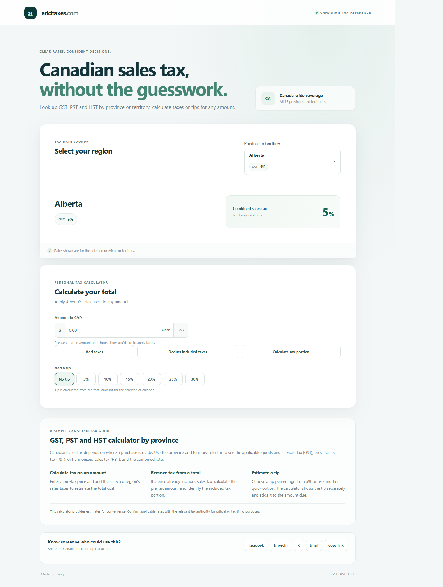

# AddTaxes.com

**A polished Canadian sales tax and tip calculator for every province and territory.**

[](https://addtaxes.com/)
[](https://react.dev/)
[](https://www.typescript-lang.org/)
[](https://vite.dev/)

AddTaxes.com makes Canadian GST, PST, HST, and tipping calculations easy to understand. Users can select a province or territory, review its applicable tax structure, and add or remove tax from an amount with instant, itemized results.

The project combines a clean, responsive interface with typed React components and practical financial calculations. It was built as a real-world reference tool, with accessibility, persistence, SEO content, and sharing features integrated into the application.

---

## Application Preview

<p align="center">
  
</p>

The interface combines a province and territory lookup with a personal tax and tip calculator. Region-aware tax information, responsive controls, and itemized results keep the experience clear across desktop and mobile without overwhelming the user.

---

## Key Features

- **Canada-wide tax lookup** for all 13 provinces and territories
- **GST, PST, and HST breakdowns** with combined regional rates
- **Tax calculations** that can add tax, deduct included tax, or calculate a tax portion
- **Tip calculator** with common preset percentages
- **Itemized CAD results** for base amount, tax, tip, and amount due
- **Province persistence** through a year-long browser cookie
- **Responsive layout** optimized for desktop and mobile
- **Accessible controls** with labels, validation feedback, and ARIA state
- **Built-in sharing** for major social platforms, email, and copying the site URL
- **SEO-focused page content** describing the Canadian sales tax workflow

## Technical Highlights

| Area | Implementation |
| --- | --- |
| UI framework | React 19 with reusable functional components |
| Type safety | TypeScript for province models and calculation data |
| Build system | Vite for fast development and optimized production builds |
| Styling | Custom CSS plus Bootstrap 5.3 utilities and components |
| State management | React hooks for region, amount, tip, mode, result, and validation state |
| Domain data | Centralized typed province configuration for GST, PST, and HST rates |
| Persistence | Cookie-based region preference with safe decoding and validation |
| Financial formatting | `Intl.NumberFormat` for Canadian locale-aware currency output |
| Validation | Numeric input guards that reject missing, negative, or invalid values |
| Sharing | Native browser clipboard support and generated platform share URLs |

## Engineering Decisions

- **Centralized tax data** keeps regional rates in one typed source of truth, preventing display and calculation values from drifting apart.
- **Derived calculations** return base amount, individual tax components, total, tip, amount due, and tax share from a single calculation flow.
- **Region-aware state** resets stale results when the selected province or amount changes, reducing the risk of showing data for the wrong region.
- **Defensive persistence** validates a saved province name and falls back to a supported default if the cookie is missing or malformed.
- **Accessible interaction** includes semantic form controls, live validation feedback, pressed states, and descriptive labels.
- **Small component boundaries** separate region selection, province display, tax calculation, sharing, and application composition.

## Project Structure

```text
src/
├── App.tsx                 # Application composition and selected-region state
├── App.css                 # Application layout and visual system
├── provinces.ts            # GST, PST, and HST data for 13 regions
├── types.ts                # Shared domain types
└── components/
    ├── ProvinceDisplay.tsx # Region and tax badge presentation
    ├── ProvinceDropDown.tsx  # Accessible province selector
    ├── TaxCalculator.tsx   # Calculation modes, validation, and results
    └── ShareLinks.tsx      # Social, email, and clipboard sharing
```

## Getting Started

### Prerequisites

- Node.js 20 or later
- npm

### Installation

```bash
npm install
```

### Development

```bash
npm run dev
```

Open the local URL printed by Vite.

### Production build

```bash
npm run build
npm run preview
```

### Quality check

```bash
npm run lint
```

## Live Website

Visit [addtaxes.com](https://addtaxes.com/) to try the calculator.

## Portfolio Value

This project demonstrates end-to-end frontend delivery: translating a practical user need into typed domain models, designing responsive interfaces, implementing financial logic, handling browser persistence, and producing a polished production-ready experience.
